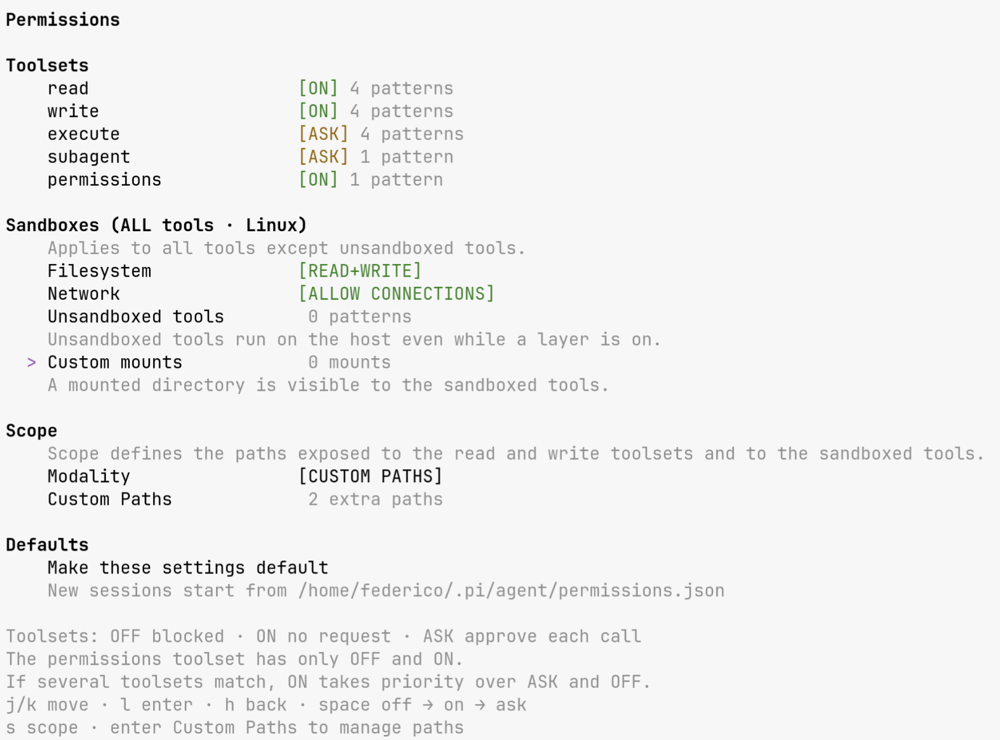

# pi-toolset-permissions

<p align="center">
  
</p>

_Do you find managing sandboxes and permissions complicated?_

This extension adopts a different modular, on-the-fly approach: you can toggle sets of tools and
sandboxes using a simple menu during the session.

You can even tell the AI what it should disable e.g. _"forbid writing on that file"_, or _"run in read-only mode now"_. The extension provides a tool to modify the list of allowed toolsets.

The AI can request state changes when the `permissions` toolset is on. Turn that toolset off to block these requests.

## Main features

- Five toolsets: `read`, `write`, `execute`, `subagent`, and `permissions`.
- Compatibility with `pi-subagent` and `herdr`.
- The LLM can ask you to change the permissions and set your preferred profile.
- Third-party tools sandboxed automatically on Linux.
- Custom toolsets for any additional tool.
- The model asks you before every change.
- In ask-mode, approval shows the exact input, and covers that one call.
- Per-session state, inherited by subagents.
- Allows global path exceptions but allows simlinks to build per-project exceptions.
- Custom mounts: expose one host directory or file to the sandbox, read-only or read-write.
- Make these settings default: the next session starts from them.

## Install

```text
pi install npm:pi-toolset-permissions
```

Try it for one session without saving it:

```text
pi -e npm:pi-toolset-permissions
```

Then open the screen with `/permissions`.

### Sandbox requirements

- **Linux**: it wraps *any* tool and requires `bubblewrap` and unprivileged user namespaces.
- **macOS**: it wraps `bash` only, through the built-in `sandbox-exec`.
- **Windows**: no backend exists, and the screen says to start Pi inside WSL2.

## Concept

A toolset is a group of tool names. Each toolset has one state: off, on, or ask.

A pattern is a regular expression. The extension tests each pattern against a tool name.

A sandbox is an operating-system boundary for shell commands.

A path scope is the set of directories that file tools can touch. PROJECT ONLY exposes only the project root. CUSTOM PATHS exposes the project root plus saved extra paths. EVERYWHERE removes the path limit.

PROJECT ONLY keeps saved extra paths but does not expose them. Scope also selects the roots for the filesystem sandbox.

The `permissions` toolset holds the `permissions` tool. Off blocks state changes through that tool, but still permits approval requests for ask tools.
The `/permissions` command always works. Use that command to turn the toolset back on.

The `permissions` toolset has only the on and off states. It does not accept ask, because every change through the tool already asks you to confirm. `set_toolset` refuses `mode: ask` for this toolset, and a stored ask value loads as on.

Bash is one tool. Its patterns sit in the execute toolset. The sandbox is a second layer. It starts the whole call inside the boundary, and it does not read the command text.

The model changes the state with the `permissions` tool. The tool asks you to agree before each change. Without a dialog, the tool cannot change the state.

## Use

Open the settings screen:

```text
/permissions
```

The main screen groups toolsets, sandboxes, scope, and the defaults row. Custom Paths opens a path submenu inside Scope, and Custom mounts opens one inside Sandboxes.

| Key | Action |
| --- | --- |
| up/k, down/j | move the selection |
| space | cycle a toolset through off → on → ask → off, toggle a sandbox, or switch the scope |
| enter/l | open toolset patterns, Unsandboxed tools, Custom mounts, or Custom Paths. On a sandbox or Modality, enter acts like space. On the defaults row, it saves the settings |
| s | cycle PROJECT ONLY → EVERYWHERE → CUSTOM PATHS |
| a | add a directory to the paths |
| d | remove the selected extra path in Custom Paths |
| esc/h | close the screen, or leave a submenu |

Each change is saved at once.

## Custom mounts

A tool sometimes needs a path that the scope does not cover: a cache, a data set, or one config file. Press enter on Custom mounts and then `a`. Type a directory or a single file. It starts read-only, `w` switches it to read-write, and `d` removes it.

One file is often what you want. A tool that publishes needs `~/.npmrc`, and a tool that commits needs `~/.gitconfig`. Mount that file alone, not the home directory.

The model can do the same with `add_mount` and `remove_mount`, and it must ask you first. A path that the scope already covers needs no mount, and a path that belongs to the sandbox, such as `/run`, is refused. Mounts apply while the filesystem layer is not `off`.

## Make these settings default

Each session keeps its own settings, so a change in one project never reaches another. Press enter on Make these settings default to write the current settings to `~/.pi/agent/permissions.json`. A new session starts from that file; the running session keeps its own.

The model can do the same with `save_defaults`, and it must ask you first.

## License

GPL-3.0-only. Copyright (C) 2026 00sapo. The full text is in [LICENSE](LICENSE).
